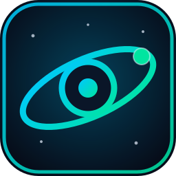
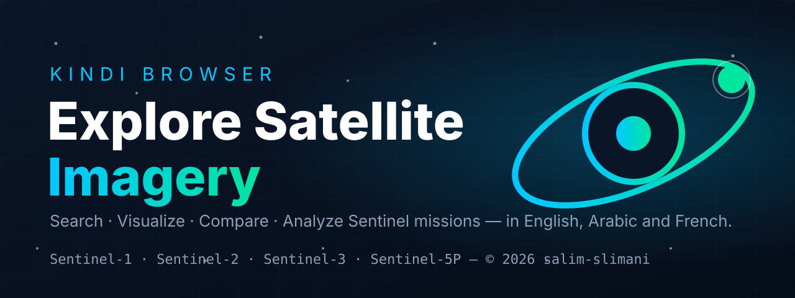

<p align="center">
  
</p>

<h1 align="center">Kindi Browser — Satellite Imagery Explorer</h1>

<p align="center">
  English-first, trilingual (EN/AR/FR) satellite imagery browser (inspired by the Copernicus Data Space Browser) for Algeria/MENA students &amp; researchers.<br>
  Vanilla HTML/CSS/JS + Leaflet. Double-click <code>index.html</code> and go.
</p>



## Run

- **Easiest:** double-click `index.html` (works via `file://`).
- **Better:** `python -m http.server 8000` inside this folder, then open `http://localhost:8000/`.

No npm, no build, no API key.

## Structure

```
index.html  styles/main.css  js/i18n.js  js/api.js  js/map.js  js/app.js
```

## Real data endpoints (all keyless, CORS-open)

| Use | Endpoint |
|---|---|
| Product search | `GET https://catalogue.dataspace.copernicus.eu/odata/v1/Products?$filter=…&$expand=Attributes&$format=json` (filter built from mission / dates / AOI WKT / cloud) |
| Quicklook | `GET https://catalogue.dataspace.copernicus.eu/odata/v1/Products(<Id>)/Quicklook` |
| Single product | `GET …/Products(<Id>)?$expand=Attributes` |
| STAC fallback | `POST https://stac.dataspace.copernicus.eu/v1/search` |
| Base imagery | NASA GIBS WMTS `https://gibs.earthdata.nasa.gov/wmts/epsg3857/best/{Layer}/default/{Time}/GoogleMapsCompatible_Level{z}/{z}/{y}/{x}.jpg` (Terra TrueColor, VIIRS, Bands721, NDVI) + OSM / Esri / CARTO |
| Geocoding | `GET https://nominatim.openstreetmap.org/search?format=json&q=` (debounced) |

## Fallback behavior

If the OData request fails (offline, CORS block, timeout > 18 s) the app tries STAC once, then renders **6 realistic demo products over Algeria** (`S2A_MSIL2A_…`, `S1A_IW_GRDH_…`, …) with a clearly-labeled amber **Demo / وضع تجريبي** badge. Footprints, analysis and queue keep working so the UI is never dead.

## Features

Search (S1/S2/S3/S5P + cloud + AOI draw) → footprints + quicklooks → visualize presets + opacity + legend → compare split slider → illustrative histogram / spectral / NDVI stats (canvas, seeded by product id) → download queue with OData/STAC link copy → 9 highlight themes × 2–3 Algerian pins → GIBS timelapse → custom WMS modal → AR/EN/FR with full RTL mirroring.

## Notes & limits

- GIBS WMTS maxes at zoom 9 (by design); use Esri/OSM for street-level zoom.
- Analysis charts are **illustrative** (derived from quicklook seed), not scientific L2 products.
- SAR VV/VH & DEM presets reuse VIIRS/NDVI tiles with distinct legends (no-key constraint).
- Total JS ≈ 44 KB, commented in English, UI strings trilingual in `js/i18n.js`.

---

© 2026 salim-slimani. Open data: Copernicus / ESA • NASA GIBS • OpenStreetMap.
